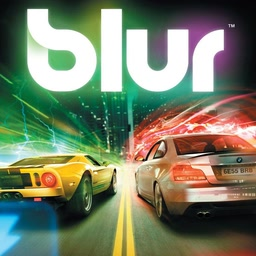

<h1 align=center>Blur: Nintendo Switch port</h1>

<b>blur-nx 1.0.2</b> · <a href="https://chanseyisthebest.github.io/blur-nx-installer/">web installer</a> · <a href="https://github.com/ChanseyIsTheBest/blur-nx/releases/tag/v1.0.2">release</a>

An unofficial port of the Xbox 360 game **Blur** (Bizarre Creations, 2010), made by static recompilation with
[ReXGlue](https://github.com/rexglue/rexglue-sdk) and drawn by [reNut](https://github.com/masterspike52/reNut)'s
renderer on deko3d. No emulator. Built on
[renut_nx_ultimate_base](https://github.com/ChanseyIsTheBest/renut_nx_ultimate_base); there is a PC build too.

This repository contains no game files. You need your own copy of the game: the Xbox 360 disc and its title update 2.

## Playing it on the Switch

1. Open the web installer: **https://chanseyisthebest.github.io/blur-nx-installer/**
2. Give it your disc image or extracted folder, then title update 2 (its Xbox 360 package or extracted folder), and
   press **Create blur-nx.zip**. It all runs in your browser.
3. If you have an older blur-nx, delete its `switch/blur-nx/game_root` folder. Extract `blur-nx.zip` to the root of
   your SD card.
4. In **Sphaira**, find Blur, press **X**, choose **Install Forwarder**, set **Address Space** to **39-bit**, choose
   **Create Forwarder**, and start the game from the Home Screen.

Features:

- Plays on the console: menus, career and races with all the game's effects (motion blur, bloom, glow, reflections).
- 30 fps most of the time at stock clocks.
- Four CPU cores when started from the forwarder.
- Game menu (hold **A+B+X+Y+L+R**): settings, the game's achievements and each player's controls.
- Options in `switch/blur-nx/blur.toml`: language, frame rate cap, handheld and docked resolutions, SMAA, MSAA,
  four-core mode, button layout and the menu's look. Everything else is built into the NRO (`app/blur_switch.toml`).
- Smaller game files (1.0.1): the installer packs the level files (LZ4 and ZXC), re-encodes the movies to H.265 for
  the Switch's video decoder and the streamed music to Opus (Chrome or Edge): 5.4 GB to about 4.2 GB.
- Saves are safe from a crash: a save is set aside while the game writes it again and comes back by itself if the
  game closes in between, and a copy of each is kept in `switch/blur-nx/save_backup/` (1.0.2).
- No log in normal play; a crash writes `switch/blur-nx/logs/rex/rex_crash.log`.

Known issues:

- Split-screen multiplayer is not tested.
- Online play needs Xbox LIVE and is not supported.

Bug reports: add `log_level = "info"` at the top of `switch/blur-nx/blur.toml`, play until the problem happens and
send the `switch/blur-nx/logs/` folder. The player's guide (SD layout, settings, game menu) is
[dist/switch/README.txt](dist/switch/README.txt).

## Building

See [docs/building.md](docs/building.md) (the base's guide). More:

- [docs/blur-notes.md](docs/blur-notes.md): this game (decisions, code generation, game fixes, the renderer)
- [docs/progress-log.md](docs/progress-log.md): the work in order
- [docs/hand-and-machine-optimising-guide.md](docs/hand-and-machine-optimising-guide.md), [docs/optimising-functions.md](docs/optimising-functions.md): the hot-function method
- [docs/off-by-default.md](docs/off-by-default.md): the base's fixes that are off, and why
- [docs/base-README.md](docs/base-README.md), [docs/ultimate-fixes.md](docs/ultimate-fixes.md): the base this port is built on

## Credits and license

- **reNut** by masterspike52: the renderer. Its author permits reuse in these ports.
- **renut_nx_ultimate_base** and the ports its fixes come from (katamari-nx, banjo-nx, sa2-nx, rr6-nx, sasrt-nx,
  kameo-nx and the others); **banjo-nx** for the renderer's adaptation and the method docs.
- **ReXGlue** for the recompiler and SDK; **NetherSX2_nx** by NaGaa95 (the four-core layout, MIT), **battd_nx** (the
  GPU arena), **bejeweled3-nx** and the **Zuma** ports (the hot-function method).

[THIRD_PARTY_NOTICES.md](THIRD_PARTY_NOTICES.md) has the full list and each project's license. GPL-3.0 where the sources are ([LICENSE](LICENSE)).

Blur is a trademark of Activision Publishing, Inc.; the icon artwork is © Activision. This project is not affiliated
with or endorsed by Activision, Bizarre Creations, Microsoft or Nintendo.
